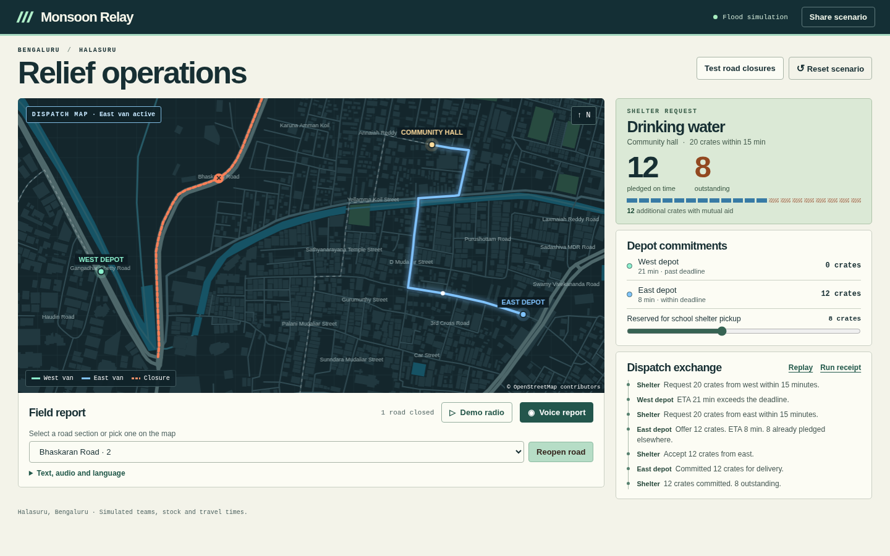

# Monsoon Relay

A volunteer reports a flooded Bengaluru road. Three agents work out which depot can still get drinking water to a shelter, while protecting stock pledged to another shelter. The map, offers, deadlines and outstanding demand update together.

**[Open the live simulator](https://monsoon-relay.vercel.app/) · [Replay the featured closure](https://monsoon-relay.vercel.app/#v=1&roads=30&reserve=8&pick=30) · [Watch the walkthrough](https://monsoon-relay.vercel.app/watch.html)**



## A 90-second judge run

1. Start on the live simulator. The community hall requests 20 water crates within 15 simulated minutes. West depot can bring all 20 in 12 minutes.
2. Choose **Demo radio**. An on-device English speech recognizer transcribes the sample. Confirm the closure of the selected Bhaskaran Road section. The first recognition downloads roughly 47 MB of recognizer code and model data. **Voice report** supports a browser microphone in English or Hindi where browser speech services are available. For a typed trial, enter `भास्करन रोड सेक्शन दो बंद है` under **Text, audio and language**.
3. West now needs 21 minutes. East offers 12 crates in eight minutes because eight of its 20 crates are reserved for the school shelter to collect. Its van holds 16. The community hall accepts the offer. Eight crates are still outstanding. The west-only baseline would pledge zero on time.
4. Change the school shelter’s reservation to 18. East's offer falls to two. **Run receipt** shows the actual stock, ETAs, messages and serialised commitments. **Share scenario** copies a replayable URL.
5. Reset and choose **Test road closures**. The simulator evaluates all 294 sections independently against the current plan. Only three individual closures force a depot handoff at the starting stock level. Apply a result, or pick another section and stack disruptions yourself.

## Run it locally

Use Node 22.12 or later and Python 3.

```sh
npm start
```

Open http://localhost:8000. The server publishes only the files copied into `dist/`. A static deployment uses `npm run build` and publishes that same directory.

For a venue rehearsal with unreliable Wi-Fi, run `python3 scripts/prepare_speech.py` while online, then `python3 -m http.server 8000 --directory dist`. That build serves the English audio model locally. On the public site, **Prepare audio for this tab** warms up recognition ahead of a demo.

## How a pledge is made

* **Intake.** The live microphone uses browser speech recognition. The sample and short English audio uploads use an integrity-pinned Vosk model running in WebAssembly on the device. A map-aware parser checks status and section identity. Closures and reopenings require confirmation.
* **Routing.** The directed Halasuru street graph has 970 nodes and 294 selectable road sections. Dijkstra search excludes closed sections and respects the bundled one-way flags. Travel estimates use a fixed 105 metres per minute plus two minutes for loading.
* **Negotiation.** West, East and the shelter run in separate browser Web Workers. A depot can reject a request or offer stock subject to availability, van capacity and the deadline. The shelter counts a pledge after an acceptance and a depot commitment. Run IDs separate simultaneous simulations. Repeated messages reuse the existing decision. The receipt identifies the actual transport, including the in-process fallback.
* **Counterfactuals.** A background worker evaluates one additional closure per open section. It ranks the results by supply loss, transfer of work from West and route delay. The west-only comparison uses exactly the same closures and stock as the coordinated run.
* **BAND.** A separate deployment runs three authenticated Node processes using the official `@band-ai/sdk`. Per-room journals persist their decisions across retries. Copy a scenario command from the receipt to reproduce it in a configured BAND room. The public browser demo works without sponsor credentials. [BAND setup and verification](integrations/band/README.md)

## Run the hosted BAND test

Once an owner key is supplied privately, `./integrations/band/run.py --test-room` provisions the three agents and a dedicated room, sends the featured scenario, and checks the signed-in shelter’s correlated 12/20 response. The runner prompts for the key privately when it is absent from the environment. [Owner setup](integrations/band/README.md)

## Verification

```sh
npm test
npm ci --prefix integrations/band
npm test --prefix integrations/band
```

The main suite covers all single-road closures, 21 stock levels, disconnected roads, concurrent transactions, duplicates, worker failure, compound closures, bilingual intent and stale voice confirmations. The stress-test suite compares 292 compound scenarios to independent agent negotiations. The BAND suite exercises the installed SDK with its test transport. A live run with three independently authenticated BAND agents produced the same 12/20 outcome. [Read the BAND receipt](docs/band-live-run.md)

For end-to-end checks, install Python Playwright and have Chromium on the path. Start the app, then run `python3 tests/browser_smoke.py` and `python3 tests/audio_smoke.py`. Set `RELAY_URL` to test another deployment. The audio test also requires FFmpeg with the Flite filter and network access to the versioned model. It decodes two distinct waveforms and verifies the map before and after confirmation.

## Data and scope

Map geometry and buildings © [OpenStreetMap contributors](https://www.openstreetmap.org/copyright), licensed under [ODbL 1.0](https://opendatacommons.org/licenses/odbl/1-0/). The extract spans 77.617–77.629° E and 12.974–12.982° N. Numbered sections identify features in this extract. Stock, actors, deadlines and travel times are simulation inputs. The results represent pledges within the simulated deadline. [Audio model and sample provenance](assets/radio/README.md)

Submission materials and the sponsor video workflow are in [SUBMISSION.md](SUBMISSION.md) and [docs/adal](docs/adal/README.md).
